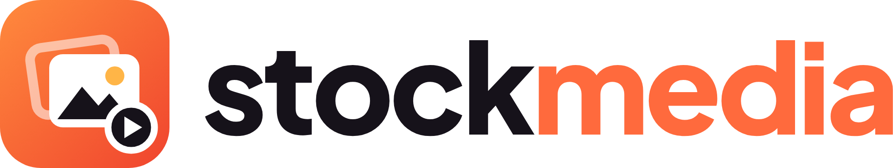

<picture>
  <source media="(prefers-color-scheme: dark)" srcset="assets/logo-dark.png">
  
</picture>

An Agent Skill that finds free stock photos and video for your web project and saves them ready to use. It searches Pexels and Pixabay together and picks the best match from either. It works with Claude Code, Codex, Gemini CLI, Cursor, GitHub Copilot, and any other AI tool that supports the [Agent Skills](https://agentskills.io) standard.

To install it, paste this into your AI tool:

```
Set up the stock-media skill by following https://raw.githubusercontent.com/dtsoden/stock-media-skill/main/SETUP.md
```

Your AI tool does the rest. It installs the skill and walks you through getting two free API keys (one from Pexels, one from Pixabay). It asks where you want to keep them, opens a text file for you to paste them into, then stores them safely and deletes the file. Your keys never go into the chat.

When it's finished, start a new session and ask for what you need:

- "Find a hero photo for this landing page"
- "Get a 10-second background video of ocean waves"
- "I need a friendly illustration for the empty state on this screen"

Photos and video come from both services. Illustrations, vector art and animations come from Pixabay alone, since Pexels only has photos and live footage. Images are resized for where they're going: WebP for web pages, JPEG or PNG for PowerPoint, Keynote, Google Slides and Word, so a deck or report doesn't balloon in size. Videos are trimmed, compressed to MP4 with the sound removed, and saved with a poster image, ready for a muted background loop.

For a longer walkthrough, read [the stock-media playbook](docs/stock-media-playbook.pdf). It lays out the problem the skill solves and what good results look like, then gives ten plays for websites, decks and documents, each with prompts you can copy word for word.

The skill can also save JPEG XL copies for web pages, but only when you ask for them, since Microsoft Edge and Office can't show the format yet. It needs the free `cjxl` tool from libjxl (`winget install libjxl.libjxl`, `brew install jpeg-xl` or `apt install libjxl-tools`). To see where the format saves space today and where to keep using JPEG, read [the JPEG XL playbook](docs/jxl-playbook.pdf).

The skill knows the limits of the free API keys and tells you when one affected its pick. The main ones: Pixabay images top out at 1280px wide, so full-width hero images come from Pexels, and Pixabay vector art downloads as PNG rather than SVG.

Pexels and Pixabay both allow free commercial use without attribution, under the [Pexels license](https://www.pexels.com/license/) and the [Pixabay content license](https://pixabay.com/service/license-summary/). Read those yourself before anything unusual, such as putting a stock image in a logo.

If you'd rather install it by hand, run `npx skills add dtsoden/stock-media-skill -g`, or copy the `skills/stock-media` folder into your AI tool's skills folder. You need Python 3 with `pip install Pillow keyring`, plus ffmpeg for video. Then store your keys with `python <skill folder>/scripts/store_keys.py` (run it with `--help` for the options).

The skill is MIT licensed. See `LICENSE`.
